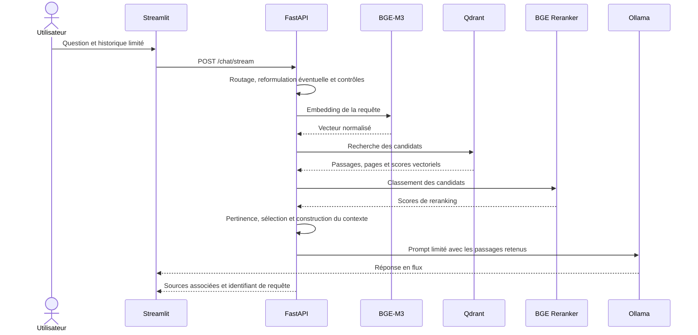

# Reproduire RSLM pas à pas

Ce guide décrit comment remettre en route le projet actuel sur un poste local,
puis comment reconstituer son pipeline documentaire avec son propre corpus.
Il s'inspire de la progression prototype → API et interface → conteneurisation
du document de conception fourni, mais les commandes ci-dessous correspondent
aux fichiers présents dans ce dépôt. Il ne faut pas réutiliser les anciens
fichiers ni les chemins spécifiques du poste d'origine.

## 1. Comprendre ce que l'on va lancer

RSLM comporte quatre composants principaux :

| Composant | Rôle |
| --- | --- |
| Streamlit | Interface conversationnelle et administration locale du corpus |
| React/Vite | Interface de comparaison expérimentale pour le chat; historique local au navigateur |
| FastAPI | Recherche, préparation du contexte, génération et endpoints d'administration |
| Sentence Transformers | Embeddings BAAI/bge-m3 et reranking BAAI/bge-reranker-v2-m3 |
| Qdrant et Ollama | Recherche vectorielle et génération du texte |

Le corpus, les fichiers de pages/chunks/embeddings, le modèle téléchargé, les
conversations, les sauvegardes et les journaux ne sont pas inclus. Préparez
uniquement des PDF dont vous pouvez légalement traiter le contenu.

## 2. Vérifier les prérequis

- Python 3.11 ou plus récent.
- Node.js 20.19+ ou 22.12+ et npm, uniquement pour l'interface React/Vite.
- Git pour cloner le dépôt, ou une copie locale du code.
- Ollama installé et accessible sur le poste.
- De l'espace disque et un accès réseau au premier lancement : Ollama et
  Sentence Transformers téléchargent les modèles requis.
- Docker Compose, uniquement pour le parcours conteneurisé (Docker Desktop sur
  Windows/macOS ou Docker Engine avec le plugin Compose sur Linux).

Installer le modèle de chat utilisé par la configuration actuelle :

```powershell
ollama pull qwen2.5:1.5b
ollama list
```

Le fichier `src/api_stream3.py` référence `qwen2.5:1.5b` pour la génération.
Les modèles BGE sont chargés par Sentence Transformers au démarrage de l'API ;
ils ne sont pas distribués dans le dépôt.

## 3. Obtenir le code et installer les dépendances

Après publication du dépôt, remplacer l'URL par l'adresse GitHub réelle :

```powershell
git clone <URL_DU_DEPOT>
Set-Location <DOSSIER_DU_DEPOT>
```

Depuis la racine du dépôt :

```powershell
python --version
python -m venv .venv
.\.venv\Scripts\Activate.ps1
python -m pip install --upgrade pip
python -m pip install -r requirements.txt
Copy-Item .env.example .env
```

Si l'activation PowerShell est bloquée par la stratégie d'exécution, utilisez
directement `.\.venv\Scripts\python.exe` pour les commandes Python ; ne
modifiez pas les paramètres de sécurité du poste uniquement pour ce projet.

### Linux et macOS (Bash ou zsh)

Depuis la racine du dépôt, après avoir installé Python 3.11 ou plus récent et
Ollama :

```sh
python3 --version
python3 -m venv .venv
. .venv/bin/activate
python -m pip install --upgrade pip
python -m pip install -r requirements.txt
cp .env.example .env
ollama pull qwen2.5:1.5b
```

Si le service Ollama n'est pas déjà démarré par votre installation, lancez
`ollama serve` dans un terminal dédié. Ces commandes documentent le parcours
Unix, mais la configuration n'est pas encore vérifiée par une matrice CI
Linux/macOS.

## 4. Configurer l'exécution locale

Ouvrir `.env` et adapter les valeurs locales si nécessaire. Pour deux services
sur le même poste, les valeurs usuelles sont :

```dotenv
OLLAMA_HOST=http://127.0.0.1:11434
RSLM_API_URL=http://127.0.0.1:8080
PUBLIC_API_BASE_URL=http://localhost:8080
XAI_TRACE_ENABLED=false
RSLM_ALLOWED_ORIGINS=http://localhost:5173
```

`RSLM_ALLOWED_ORIGINS` accepte une liste d'origines séparées par des
virgules. Gardez uniquement les origines locales par défaut ; CORS ne protège
pas l'API contre un accès non autorisé.

Pour autoriser l'import et l'administration des PDF, créer une clé locale :

```powershell
python -c "import secrets; print(secrets.token_urlsafe(32))"
```

Copier la valeur générée dans `RSLM_ADMIN_KEY` de `.env`. Saisir la même clé
dans la barre latérale Streamlit lorsqu'une opération d'administration est
nécessaire. Ne pas partager la clé ni committer `.env`.

La trace XAI est désactivée par défaut : elle peut enregistrer du texte de
conversation, des passages retrouvés et des réponses.
Les journaux d'audit et les diagnostics contenant des questions ou des extraits
sont aussi désactivés par défaut (`AUDIT_LOG_ENABLED=false` et
`RSLM_DEBUG_CONTENT_LOGS=false`). Ne les activez que pour un diagnostic
local nécessaire, puis protégez et supprimez les journaux correspondants.

## 5. Démarrer l'application sans corpus

Démarrer Ollama, puis lancer l'API dans le premier terminal :

```powershell
.\.venv\Scripts\python.exe -m uvicorn src.api_stream3:app --host 127.0.0.1 --port 8080
```

Au premier lancement, l'API charge les modèles d'embedding et de reranking.
Cette étape peut prendre plusieurs minutes selon la machine et le réseau.
Sans `data/embeddings.json`, elle crée une collection Qdrant vide.

Vérifier l'API dans un autre terminal :

```powershell
Invoke-WebRequest http://127.0.0.1:8080/openapi.json
```

Démarrer Streamlit dans un deuxième terminal :

```powershell
$env:RSLM_API_URL = "http://127.0.0.1:8080"
.\.venv\Scripts\python.exe -m streamlit run src\app_stream.py
```

Ouvrir `http://localhost:8501`. Sans corpus, une question documentaire ne
doit pas produire de réponse inventée prétendument issue de documents : il
faut d'abord indexer des PDF.

Sous Linux/macOS, avec l'environnement virtuel activé, utilisez ces commandes
dans deux terminaux :

```sh
python -m uvicorn src.api_stream3:app --host 127.0.0.1 --port 8080
```

```sh
RSLM_API_URL=http://127.0.0.1:8080 python -m streamlit run src/app_stream.py
```

Pour comparer l'interface React, garder l'API démarrée et utiliser un autre
terminal depuis la racine du dépôt :

```powershell
Set-Location frontend
npm install
Copy-Item .env.example .env.local
npm run dev
```

Ouvrir `http://localhost:5173`. Sous Linux/macOS, remplacer `Copy-Item` par
`cp .env.example .env.local`. L'administration des documents reste dans
Streamlit; l'historique du frontend React est conservé dans le navigateur.

Pour interroger les PDF existants dans `documents/`, définir `RSLM_ADMIN_KEY`
dans `.env` avant de lancer l'API. Dans le panneau « Corpus documentaire » de
React, saisir cette clé et charger la liste. Les PDF marqués « À indexer »
peuvent ensuite être indexés depuis leur ligne. Un fichier déposé dans le
dossier n'est pas indexé automatiquement; la réindexation d'un PDF déjà
indexé crée d'abord une sauvegarde.

## 6. Ajouter et indexer un corpus autorisé

### Méthode recommandée : interface d'administration

1. Confirmer les droits d'utilisation des PDF et conserver une copie originale.
2. Démarrer l'API avec `RSLM_ADMIN_KEY` configuré.
3. Ouvrir Streamlit et saisir la même clé dans la barre latérale.
4. Importer les PDF ; l'API limite la taille d'un fichier et vérifie son format.
5. Attendre la fin de l'indexation, puis contrôler l'état des documents depuis
   l'interface.
6. Poser quelques questions dont les réponses et pages pertinentes peuvent
   être vérifiées manuellement.

Cette méthode indexe chaque document et met à jour Qdrant et le fichier
d'embeddings local.

### Méthode par scripts de préparation

Pour préparer tous les PDF d'un dossier local :

1. Placer les PDF autorisés dans `documents/`.
2. Extraire texte et numéros de page :

   ```powershell
   .\.venv\Scripts\python.exe -m src.prepare_documents
   ```

3. Nettoyer les en-têtes et pieds de page répétés et produire les passages :

   ```powershell
   .\.venv\Scripts\python.exe -m src.create_chunks
   ```

   Le découpage suit les sections détectées, avec une cible de 5 000
   caractères et un chevauchement de 300 caractères pour les longues
   sections. Ces paramètres sont des choix d'implémentation à réévaluer sur
   d'autres types de documents.

4. Calculer et enregistrer les embeddings :

   ```powershell
   .\.venv\Scripts\python.exe -m src.create_embeddings
   ```

   Le temps et la mémoire nécessaires dépendent du nombre de pages, du modèle
   et du matériel. Ne supposez pas une durée fixe.

5. Créer ou synchroniser l'index vectoriel local :

   ```powershell
   .\.venv\Scripts\python.exe -m src.create_vector_db
   ```

Les scripts écrivent dans `data/`, qui est ignoré par Git. Ne versionnez ni
les PDF ni les fichiers générés.

## 7. Comprendre le parcours d'une question



Les contrôles de pertinence réduisent les réponses hors corpus, mais ne
garantissent pas l'exactitude de chaque affirmation. Vérifier les extraits
cités dans le document d'origine.

## 8. Tester et évaluer

Exécuter les tests automatisés :

```powershell
.\.venv\Scripts\python.exe -m unittest discover -s tests -v
.\.venv\Scripts\python.exe -m compileall -q src tests
```

L'évaluation de recherche requiert un jeu local
`data/retrieval_eval.json`, annoté avec les documents et plages de pages
attendus :

```powershell
.\.venv\Scripts\python.exe -m src.evaluate_retrieval --top-k 10
```

Pour évaluer les réponses, préparer aussi `data/answer_eval.json`, démarrer
l'API et exécuter :

```powershell
.\.venv\Scripts\python.exe -m src.evaluate_answers
```

Ces évaluations lexicales aident à suivre les régressions ; elles ne prouvent
pas l'entailment, la vérité d'une réponse ou la fidélité des citations.
Examiner manuellement les affirmations importantes et leurs extraits sources.

## 9. Parcours conteneurisé facultatif

Docker Compose démarre l'API et Qdrant dans un index distinct de la base
Qdrant locale. Ollama reste un service sur l'hôte :

```powershell
docker compose config --quiet
docker compose up --build
```

Les ports de l'API et de Qdrant sont publiés uniquement sur `127.0.0.1`.
Conservez cette liaison locale ; ne l'élargissez pas à toutes les interfaces
réseau pour une démonstration publique.

Dans Compose, `OLLAMA_HOST` pointe vers
`http://host.docker.internal:11434`. Les PDF sont montés depuis `documents/`
et les journaux depuis `logs/` ; les modèles et les conversations ne sont pas
intégrés dans l'image. Le premier démarrage sans corpus crée un index Qdrant
vide. Les images Docker publiques n'embarquent pas de données utilisateur.

Pour arrêter les services sans supprimer les volumes :

```powershell
docker compose down
```

Ne pas ajouter `--volumes` si l'on souhaite préserver le stockage Qdrant.

## 10. Dépannage courant

| Symptôme | Vérification |
| --- | --- |
| Streamlit n'atteint pas l'API | Vérifier `RSLM_API_URL`, le port, et que l'API est démarrée dans un autre terminal. |
| Ollama ne répond pas | Exécuter `ollama list` ; vérifier `OLLAMA_HOST` et que le modèle `qwen2.5:1.5b` est disponible. |
| Qdrant refuse la connexion | Pour l'exécution locale, arrêter toute autre instance qui verrouille `data/qdrant`; Compose utilise un stockage séparé. |
| Aucune réponse documentaire | Vérifier que le PDF est indexé, que la recherche ne l'exclut pas et que le corpus contient du texte extractible. |
| Les pages sont mal citées | Contrôler l'extraction PDF et les métadonnées de page ; comparer à la page d'origine. |
| Docker ne joint pas Ollama | Vérifier `host.docker.internal:11434` depuis Docker et le moteur Docker Desktop. |
| La première réponse est lente | Les modèles chargent au démarrage et le reranking/génération sollicite CPU/GPU ; examiner les journaux locaux sans les publier. |

## 11. Partage et déploiement

Le site GitHub Pages de ce dépôt est une présentation statique ; il ne rend
pas l'API locale accessible sur Internet. Ne partagez pas un tunnel temporaire
vers Streamlit comme méthode de déploiement : cela peut exposer l'application,
les documents et les opérations d'administration sans les contrôles requis.

Avant de concevoir un véritable service public, prévoir une architecture
hébergée avec authentification, autorisation par utilisateur, TLS, isolation
du stockage, limites de débit et de taille, supervision, sauvegardes hors
machine, politique de conservation et évaluation de sécurité. Ce déploiement
public ne fait pas partie de cette procédure de reproduction locale.
