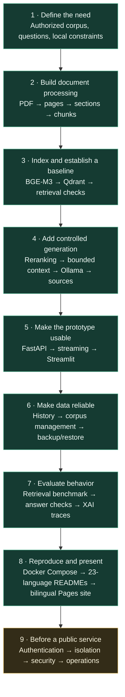

# Realistic project implementation stages

This diagram describes RSLM's technical evolution and reproduction path.
It distinguishes capabilities present in the repository from work that is
not yet a production deployment.

## Overview

## Milestones, deliverables, and evidence

| Milestone | Work | Evidence in the repository |
| --- | --- | --- |
| 1. Scope | Define users, questions, PDF rights, and privacy constraints. | A local authorized corpus and annotated questions, supplied by the person reproducing the project. |
| 2. Ingestion | Extract PDF pages, preserve page metadata, clean repeated lines, and chunk by section. | `src/prepare_documents.py`, `src/create_chunks.py`. |
| 3. Retrieval | Create embeddings and an index, test retrieval, and inspect returned pages. | `src/create_embeddings.py`, `src/create_vector_db.py`, `src/search.py`. |
| 4. RAG | Rerank candidates, bound context, generate answers from sources, and check out-of-corpus behavior. | `src/api_stream3.py`, `src/retrieval.py`. Guardrails reduce risk but do not prove truth. |
| 5. Usable application | Expose FastAPI routes and provide chat, streaming, sources, and feedback in Streamlit. | `src/api_stream3.py`, `src/app_stream.py`. |
| 6. Data reliability | Persist history, manage PDFs and Qdrant passages, and back up/restore data. | `src/chat_store.py`, `src/backup_store.py`, admin routes, and storage tests. |
| 7. Evaluation and observability | Benchmark retrieval, check lexical answer coverage and provenance, and log stages when tracing is enabled. | `src/evaluate_retrieval.py`, `src/evaluate_answers.py`, `src/xai_trace.py`. Private reference datasets are not included. |
| 8. Reproducibility and presentation | Document local and Docker workflows, exclude local data, provide README overviews in 23 languages, and maintain detailed guides/site in French and English. | Dockerfile, Compose, `docs/`, `docs/readme/`, `site/`, and the Pages workflow. Docker Pages does not host the API. |
| 9. Public operations | Protect accounts and documents, isolate tenants, monitor, and respond to incidents. | **Not delivered:** a separate security review and operational design are required before public exposure. |

## Recommended reproduction order

1. Run the application locally without a corpus and verify startup.
2. Index a small authorized corpus and check page extraction manually.
3. Tune chunking using measured retrieval quality on annotated questions.
4. Evaluate retrieval before drawing conclusions about generated answers.
5. Separately inspect the supplied passages, citations, and generated claims.
6. Add Compose after local validation; its index and data are separate.
7. Design public deployment only after access, privacy, operations, and
   incident response are defined.

## Limitations to state in a presentation

- Similarity scores are not probabilities of truth.
- A source present in context does not prove it supports every answer claim.
- Lexical evaluation does not replace human review.
- Local models can be slow and may require suitable hardware.
- GitHub Pages is a static showcase; it contains no chatbot, corpus, or
  inference endpoint.
- Public-ready global authentication, tenant isolation, public rate limits,
  production monitoring, and incident response are not delivered.
