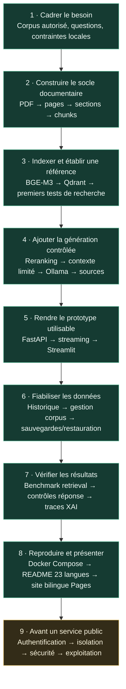

# Étapes réalistes de réalisation du projet

Ce schéma décrit l'évolution technique de RSLM et ce qui est nécessaire
pour le reproduire. Il distingue les capacités présentes dans le code des
travaux qui ne sont pas encore un déploiement de production.

## Vue d'ensemble

## Jalons, livrables et preuves

| Jalon | Travail | Livrable vérifiable dans le dépôt |
| --- | --- | --- |
| 1. Cadrage | Définir les utilisateurs, les questions d'usage, les droits sur les PDF et les contraintes de confidentialité. | Un corpus local autorisé et un jeu de questions annotées — à fournir par la personne qui reproduit le projet. |
| 2. Ingestion | Extraire les pages PDF, préserver les métadonnées de page, nettoyer les éléments répétitifs et découper par section. | `src/prepare_documents.py`, `src/create_chunks.py`. |
| 3. Recherche | Calculer les embeddings, créer l'index, tester la récupération et inspecter les pages remontées. | `src/create_embeddings.py`, `src/create_vector_db.py`, `src/search.py`. |
| 4. RAG | Reranker les candidats, limiter le contexte et demander une réponse fondée sur les sources; contrôler les réponses hors corpus. | `src/api_stream3.py`, `src/retrieval.py`. Les garde-fous réduisent le risque, sans prouver la vérité. |
| 5. Produit utilisable | Exposer des routes FastAPI et proposer chat, streaming, sources et retours dans Streamlit. | `src/api_stream3.py`, `src/app_stream.py`. |
| 6. Fiabilité des données | Conserver l'historique, gérer les PDF et les passages Qdrant, sauvegarder et restaurer. | `src/chat_store.py`, `src/backup_store.py`, routes d'administration et tests de stockage. |
| 7. Évaluation et observabilité | Mesurer le classement sur des labels; vérifier couverture lexicale et provenance; enregistrer les étapes si les traces sont activées. | `src/evaluate_retrieval.py`, `src/evaluate_answers.py`, `src/xai_trace.py`. Les jeux de référence privés ne sont pas distribués. |
| 8. Reproductibilité et présentation | Décrire les parcours local et Docker, exclure les données locales, fournir des résumés README dans 23 langues et des guides/site détaillés en français et anglais. | Dockerfile, Compose, `docs/`, `docs/readme/`, `site/` et workflow Pages. Docker Pages ne remplace pas l'hébergement de l'API. |
| 9. Exploitation publique | Protéger comptes et documents, isoler tenants, superviser et intervenir lors d'incidents. | **Non livré :** il faut une revue sécurité et une conception d'exploitation distinctes avant d'exposer une API publique. |

## Ordre de reproduction conseillé

1. Reproduire d'abord l'application locale sans corpus et vérifier le démarrage.
2. Indexer un petit corpus autorisé et vérifier manuellement l'extraction des
   pages.
3. Ajuster le découpage en mesurant la qualité sur des questions de référence.
4. Évaluer la recherche avant de tirer des conclusions sur la génération.
5. Vérifier séparément les passages transmis, les citations et les affirmations
   produites.
6. Ajouter Compose seulement après validation en local ; son index et ses
   données sont séparés.
7. Ne préparer un déploiement public qu'après avoir défini l'accès, la
   confidentialité, l'exploitation et la réponse aux incidents.

## Limites à signaler dans une présentation

- Les scores de similarité ne sont pas des probabilités de vérité.
- Une source présente dans le contexte ne prouve pas qu'elle étaye chaque
  phrase de la réponse.
- Les contrôles d'évaluation lexicale ne remplacent pas une revue humaine.
- Les modèles locaux peuvent être lents ou nécessiter du matériel spécifique.
- Le site GitHub Pages est une vitrine statique et ne contient ni chatbot, ni
  corpus, ni endpoint d'inférence.
- Authentification globale, isolation de comptes, limites publiques, supervision
  de production et procédure d'incident ne sont pas livrées comme service
  public prêt à exploiter.
