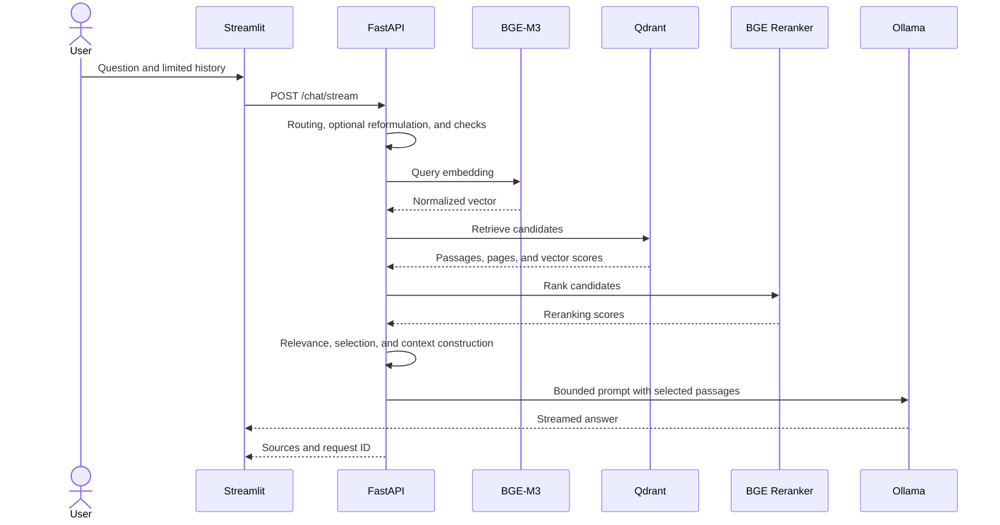

# Reproduce RSLM step by step

This guide explains how to run the current project locally and rebuild its
document pipeline with your own corpus. It follows the prototype → API and UI
→ containerization progression of the supplied design document, but the
commands below match the files in this repository. Do not reuse retired
prototypes or machine-specific paths.

## 1. Understand what you will run

| Component | Responsibility |
| --- | --- |
| Streamlit | Conversational UI and local corpus administration |
| React/Vite | Experimental chat comparison UI; browser-local history |
| FastAPI | Retrieval, context preparation, generation, and admin endpoints |
| Sentence Transformers | BAAI/bge-m3 embeddings and BAAI/bge-reranker-v2-m3 reranking |
| Qdrant and Ollama | Vector retrieval and text generation |

PDFs, page/chunk/embedding files, downloaded models, conversations, backups,
and logs are not included. Use documents you are authorized to process.

## 2. Check prerequisites

- Python 3.11 or newer.
- Node.js 20.19+ or 22.12+ and npm, only for the React/Vite interface.
- Git, or a local copy of the source.
- Ollama installed and reachable on the machine.
- Disk space and network access on first startup to download models.
- Docker Compose for the optional container workflow (Docker Desktop on
  Windows/macOS, or Docker Engine with the Compose plugin on Linux).

Pull the chat model referenced by the current application:

```powershell
ollama pull qwen2.5:1.5b
ollama list
```

`src/api_stream3.py` references `qwen2.5:1.5b` for generation. Sentence
Transformers downloads the BGE embedding and reranking models during API
startup; their weights are not part of this repository.

## 3. Get the code and install dependencies

After the repository is published, replace the URL with its real GitHub URL:

```powershell
git clone <REPOSITORY_URL>
Set-Location <REPOSITORY_DIRECTORY>
```

From the repository root:

```powershell
python -m venv .venv
.\.venv\Scripts\Activate.ps1
python -m pip install --upgrade pip
python -m pip install -r requirements.txt
Copy-Item .env.example .env
```

If PowerShell activation is restricted, invoke `.\.venv\Scripts\python.exe`
directly instead of changing machine execution policy for this project.

### Linux and macOS (Bash or zsh)

From the repository root, after installing Python 3.11 or newer and Ollama:

```sh
python3 --version
python3 -m venv .venv
. .venv/bin/activate
python -m pip install --upgrade pip
python -m pip install -r requirements.txt
cp .env.example .env
ollama pull qwen2.5:1.5b
```

If your Ollama installation does not already start its service, run
`ollama serve` in a dedicated terminal. These commands document the Unix
workflow, but it is not yet verified by a Linux/macOS CI matrix.

## 4. Configure local services

Set local values in `.env`, for example:

```dotenv
OLLAMA_HOST=http://127.0.0.1:11434
RSLM_API_URL=http://127.0.0.1:8080
PUBLIC_API_BASE_URL=http://localhost:8080
XAI_TRACE_ENABLED=false
RSLM_ALLOWED_ORIGINS=http://localhost:5173
```

`RSLM_ALLOWED_ORIGINS` accepts a comma-separated list of origins. Keep only
local origins by default; CORS does not protect the API from unauthorized
access.

To enable PDF upload and corpus administration, generate a local key:

```powershell
python -c "import secrets; print(secrets.token_urlsafe(32))"
```

Store it as `RSLM_ADMIN_KEY` in `.env` and enter the same value in the
Streamlit sidebar when needed. Never share the key or commit `.env`.

XAI tracing is disabled by default because it can retain conversation text,
retrieved passages, and answers.
Audit logs and diagnostics containing questions or excerpts are also disabled
by default (`AUDIT_LOG_ENABLED=false` and
`RSLM_DEBUG_CONTENT_LOGS=false`). Enable them only for necessary local
debugging, then protect and remove the resulting logs.

## 5. Start the application without a corpus

Start Ollama, then launch the API in the first terminal:

```powershell
.\.venv\Scripts\python.exe -m uvicorn src.api_stream3:app --host 127.0.0.1 --port 8080
```

On first startup, embedding and reranking models are loaded. This may take
several minutes depending on hardware and network speed. Without
`data/embeddings.json`, the API creates an empty Qdrant collection.

Check the API from another terminal:

```powershell
Invoke-WebRequest http://127.0.0.1:8080/openapi.json
```

Start Streamlit in a second terminal:

```powershell
$env:RSLM_API_URL = "http://127.0.0.1:8080"
.\.venv\Scripts\python.exe -m streamlit run src\app_stream.py
```

Open `http://localhost:8501`. With no corpus, document questions should not
be presented as answers grounded in documents; index PDFs first.

On Linux/macOS, with the virtual environment activated, use these commands
in two terminals:

```sh
python -m uvicorn src.api_stream3:app --host 127.0.0.1 --port 8080
```

```sh
RSLM_API_URL=http://127.0.0.1:8080 python -m streamlit run src/app_stream.py
```

To compare the React UI, keep the API running and use another terminal from
the repository root:

```powershell
Set-Location frontend
npm install
Copy-Item .env.example .env.local
npm run dev
```

Open `http://localhost:5173`. On Linux/macOS, replace `Copy-Item` with
`cp .env.example .env.local`. Corpus administration remains in Streamlit;
React conversation history is stored in this browser.

To query PDFs already in `documents/`, set `RSLM_ADMIN_KEY` in `.env` before
starting the API. In React’s “Corpus documentaire” panel, enter the key and
load the list. Click **Indexer** for files marked as not indexed. A PDF
copied into the folder is not indexed automatically; reindexing an already
indexed PDF first creates a backup.

## 6. Add and index an authorized corpus

### Recommended: admin interface

1. Confirm you have the right to use the PDFs and keep an original copy.
2. Start the API with `RSLM_ADMIN_KEY` configured.
3. Open Streamlit and enter the same key in the sidebar.
4. Upload PDFs. The API validates the file type and applies an upload limit.
5. Wait for indexing to complete and check the document status in the UI.
6. Ask questions whose answers and page references you can verify manually.

This path indexes documents and updates both Qdrant and the local embedding
snapshot.

### Preparation scripts

To prepare authorized PDFs from a local folder:

1. Place PDFs in `documents/`.
2. Extract text and page numbers:

   ```powershell
   .\.venv\Scripts\python.exe -m src.prepare_documents
   ```

3. Clean repeated headers/footers and create passages:

   ```powershell
   .\.venv\Scripts\python.exe -m src.create_chunks
   ```

   Chunking follows detected sections. Long sections use a 5,000-character
   target and a 300-character overlap. These are implementation choices to
   re-evaluate for different document types.

4. Calculate and save embeddings:

   ```powershell
   .\.venv\Scripts\python.exe -m src.create_embeddings
   ```

   Runtime and memory usage depend on corpus size, model, and hardware; there
   is no fixed processing time.

5. Create or synchronize the local vector index:

   ```powershell
   .\.venv\Scripts\python.exe -m src.create_vector_db
   ```

Generated files live under Git-ignored `data/`. Do not version PDFs or derived
files.

## 7. Follow a question through the system



Relevance checks reduce out-of-corpus answers but cannot guarantee every
statement is accurate. Verify cited passages in the original document.

## 8. Test and evaluate

Run automated tests:

```powershell
.\.venv\Scripts\python.exe -m unittest discover -s tests -v
.\.venv\Scripts\python.exe -m compileall -q src tests
```

Retrieval evaluation requires a local `data/retrieval_eval.json` annotated
with expected documents and page ranges:

```powershell
.\.venv\Scripts\python.exe -m src.evaluate_retrieval --top-k 10
```

Answer evaluation also needs `data/answer_eval.json`. Start the API, then run:

```powershell
.\.venv\Scripts\python.exe -m src.evaluate_answers
```

These lexical checks help detect regressions; they do not prove entailment,
truth, or citation fidelity. Manually review important claims and their
evidence.

## 9. Optional container workflow

Docker Compose runs the API and Qdrant with an index separate from local
Qdrant. Ollama remains a host service:

```powershell
docker compose config --quiet
docker compose up --build
```

The API and Qdrant ports are published on `127.0.0.1` only. Keep this local
binding; do not broaden it to all network interfaces for a public demo.

Within Compose, `OLLAMA_HOST` points to
`http://host.docker.internal:11434`. PDFs are mounted from `documents/` and
logs from `logs/`; model weights and conversations are not baked into the
image. Compose starts with an empty Qdrant collection if no corpus is
provided. Public images do not contain user data.

Stop services without deleting volumes:

```powershell
docker compose down
```

Do not pass `--volumes` if you need to preserve Qdrant storage.

## 10. Common troubleshooting

| Symptom | Check |
| --- | --- |
| Streamlit cannot reach the API | Check `RSLM_API_URL`, the port, and that the API runs in another terminal. |
| Ollama is unavailable | Run `ollama list`; check `OLLAMA_HOST` and that `qwen2.5:1.5b` is available. |
| Qdrant cannot connect | Stop other local processes locking `data/qdrant`; Compose uses separate storage. |
| No document-grounded answer | Check that the PDF is indexed, not excluded, and contains extractable text. |
| Page citations are wrong | Inspect PDF extraction and page metadata against the original. |
| Docker cannot reach Ollama | Check `host.docker.internal:11434` and the Docker Desktop engine. |
| First answer is slow | Models load at startup and reranking/generation use CPU/GPU; inspect local logs without publishing them. |

## 11. Sharing and deployment

The GitHub Pages website is static documentation; it does not make the local
API accessible on the Internet. Do not share a temporary tunnel to Streamlit
as a deployment strategy: it may expose the app, documents, and admin
operations without required controls.

Before building a public service, design hosted authentication,
per-user authorization, TLS, storage isolation, request and size limits,
monitoring, off-machine backups, retention policies, and security incident
response. A public API deployment is outside this local reproduction guide.
